# Project Documentation: Student Portfolio & Academic Management Website

**Course:** COS 106 – Introduction to Web Technologies (Practical Term Project)
**Author:** Adebola Mojolaoluwa Joy · B.Sc. Software Engineering, MIVA Open University
**Live site:** https://mojolaoluwajoy.vercel.app (also on GitHub Pages: https://mojolaoluwajoy.github.io/student-portfolio/)
**Source code:** https://github.com/Mojolaoluwajoy/student-portfolio

> The [README](../README.md) gives a quick overview. This document explains in detail **what** the website does, **how** it is built, and shows each feature working with screenshots.

---

## Table of contents

1. [What the project is](#1-what-the-project-is)
2. [Technologies used](#2-technologies-used)
3. [Project structure](#3-project-structure)
4. [Page-by-page walkthrough](#4-page-by-page-walkthrough)
   - [Home](#41-home-page-indexhtml)
   - [About Me](#42-about-me-page-abouthtml)
   - [Projects](#43-projects-page-projectshtml)
   - [Study Planner](#44-study-planner-plannerhtml)
   - [Contact](#45-contact-page-contacthtml)
5. [Responsive design and mobile menu](#5-responsive-design-and-mobile-menu)
6. [Light and dark mode](#6-light-and-dark-mode)
7. [How it works: HTML](#7-how-it-works-html)
8. [How it works: CSS](#8-how-it-works-css)
9. [How it works: JavaScript](#9-how-it-works-javascript)
10. [Running, testing and deploying](#10-running-testing-and-deploying)
11. [Limitations and future improvements](#11-limitations-and-future-improvements)

---

## 1. What the project is

The project is a **personal portfolio and academic management website**. It has five pages and serves two purposes:

- **A portfolio** that introduces the author: who she is, her education, work experience, skills and software projects, plus a way to get in touch.
- **An academic tool** (the Study Planner) that a student can use to record assignments, set due dates and priorities, tick them off when finished, and keep the list between visits.

The site is built with **plain HTML, CSS and JavaScript only**. It uses no frameworks, libraries, build tools or server. This keeps it simple to run (open a file in a browser) and simple to host (GitHub Pages).

### Goals

| Goal | How it is achieved |
|---|---|
| Present the author professionally | Consistent maroon-and-gold theme, profile photo, clear navigation, project cards |
| Show HTML skills | Semantic layout, tables, forms, lists, images, links and a `<video>` element |
| Show CSS skills | One shared stylesheet with variables, Flexbox, Grid, transitions, keyframe animations and media queries |
| Show JavaScript skills | Form validation, DOM manipulation, event handling, arrays of objects and `localStorage` |
| Work on every device | Responsive layout plus a ☰ menu on small screens |
| Comfortable to read day or night | Light and dark themes with a toggle button |

---

## 2. Technologies used

| Technology | Used for |
|---|---|
| **HTML5** | Page structure and content (5 pages) |
| **CSS3** | All styling, layout, animations and responsiveness (`css/style.css`) |
| **JavaScript (ES5, vanilla)** | Interactivity: menu, form validation, planner (`js/main.js`) |
| **Web Storage API (`localStorage`)** | Saving planner tasks in the browser |
| **SVG** | Lightweight project banner images |
| **MP4 video** | Screen recording of the planner in action |
| **Git + GitHub** | Version control |
| **GitHub Pages** | Free static hosting |

---

## 3. Project structure

```
student-portfolio/
├── index.html          Home page
├── about.html          About Me page
├── projects.html       Projects page
├── planner.html        Study Planner page
├── contact.html        Contact page
├── css/
│   └── style.css       One stylesheet shared by every page
├── js/
│   └── main.js         One script shared by every page
├── images/
│   ├── profile.jpg     Profile photo
│   ├── project-*.svg   Banner image for each project card
│   └── video-poster.svg  Placeholder shown before the video plays
├── media/
│   └── planner-demo.mp4  Demo video of the planner
├── docs/
│   ├── DOCUMENTATION.md  This document
│   └── screenshots/      Images used in this document
└── README.md           Short overview
```

**Design decision: one CSS file and one JS file for all pages.** Every page links the same `css/style.css` and `js/main.js`. The header, footer and colours stay identical everywhere and only need to be changed in one place. The script checks which elements exist on the current page and only runs the parts that apply (see [section 9](#9-how-it-works-javascript)).

---

## 4. Page-by-page walkthrough

Every page shares the same layout:

- a **header** with the author's name (which links back to Home), the navigation menu with the current page highlighted in gold, and a 🌙/☀️ button for switching between light and dark mode;
- the page's **main content**;
- a **footer** with a copyright line whose year is filled in automatically by JavaScript.

### 4.1 Home page (`index.html`)

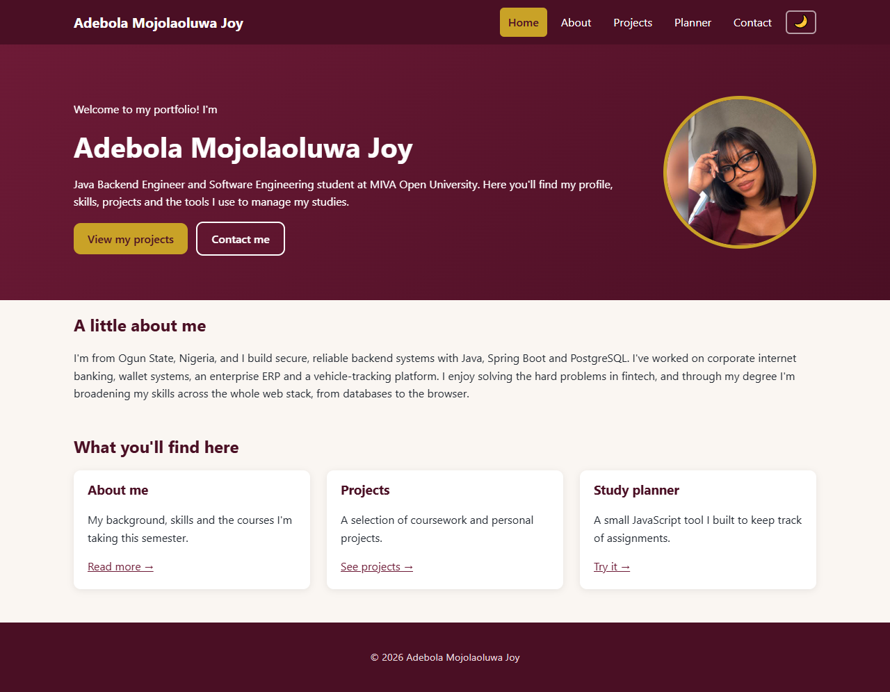

**What it shows**
- A **hero banner** with a welcome message, the author's name, a one-line introduction and a circular profile photo.
- Two call-to-action buttons: **View my projects** (solid gold) and **Contact me** (outlined).
- A short biography under **"A little about me"**.
- Three **cards** linking to the About, Projects and Planner pages.

**How it works**
- The hero uses **Flexbox** to place the text and photo side by side. On narrow screens it switches to `flex-direction: column-reverse`, so the photo appears above the text.
- The cards sit in a **CSS Grid** (`repeat(auto-fit, minmax(260px, 1fr))`). The browser fits as many 260 px-wide columns as the screen allows, so there are 3 columns on a laptop and 1 on a phone, without extra code.
- When the page loads, the content **fades up** into place (`fadeUp` keyframe animation).

### 4.2 About Me page (`about.html`)

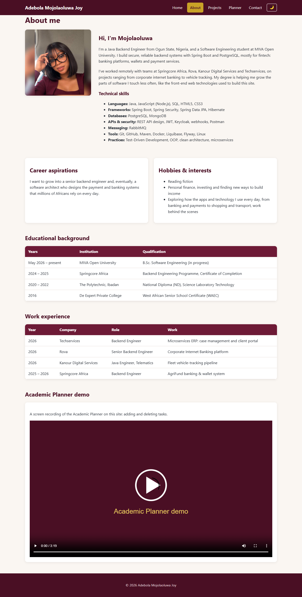

**What it shows**
- Profile photo and introduction.
- **Technical skills**, grouped as a list: languages, frameworks, databases, APIs & security, messaging, tools and practices.
- **Career aspirations** and **Hobbies & interests** in two cards.
- **Educational background** and **Work experience** in two HTML tables.
- An **Academic Planner demo** video, played with the HTML `<video>` element.

**How it works**
- The photo and introduction use a two-column grid (`280px 1fr`). Below 800 px wide it becomes one column.
- The tables use proper `<thead>`, `<tbody>`, `<th>` and `<td>` elements, so screen readers can announce the column headings.
- The video has `controls` (play, pause, volume and fullscreen) and `preload="metadata"`, so the 9.7 MB file is not downloaded until the visitor presses play. A `poster` image is shown until then.

### 4.3 Projects page (`projects.html`)

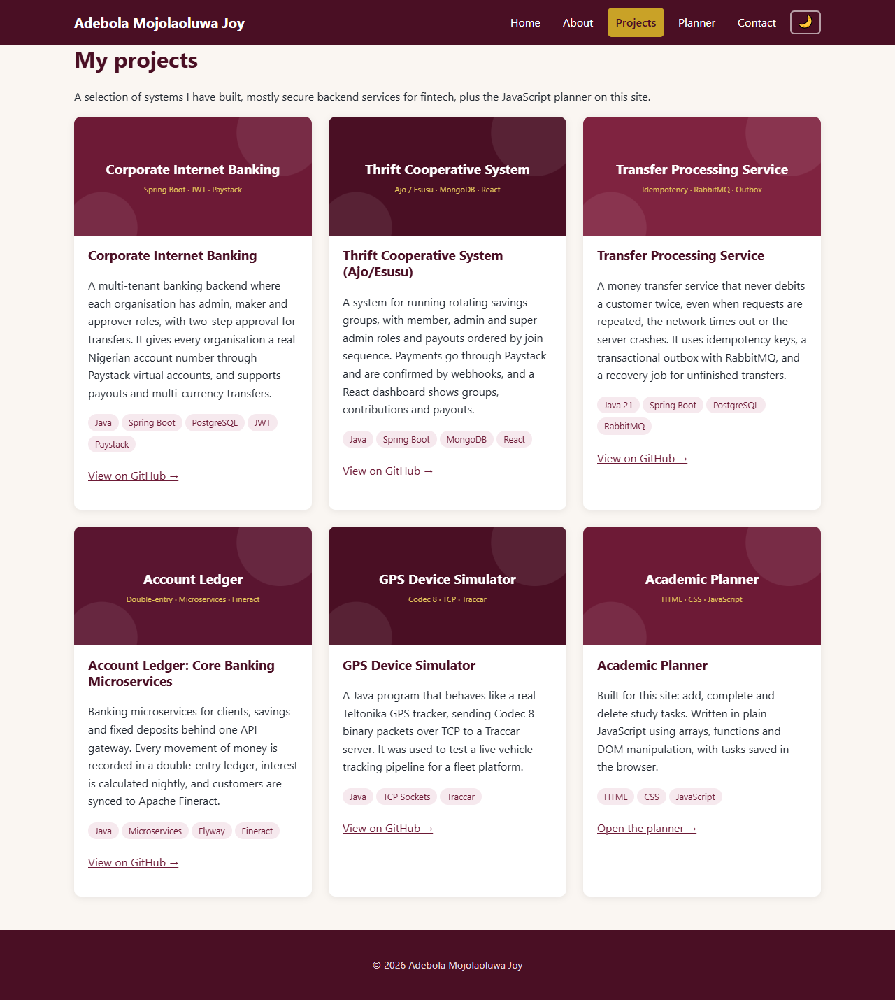

**What it shows:** six project cards. Each card has a banner image, title, description, technology **tags** and a link to the project's GitHub repository (or, for the planner, to the planner page).

| Project | Summary |
|---|---|
| Corporate Internet Banking | Multi-tenant banking backend with maker/approver roles and Paystack virtual accounts |
| Thrift Cooperative System | Rotating savings groups (Ajo/Esusu) with Paystack webhooks and a React dashboard |
| Transfer Processing Service | Transfers that never double-debit, using idempotency keys, an outbox and RabbitMQ |
| Account Ledger | Core banking microservices with a double-entry ledger and Apache Fineract sync |
| GPS Device Simulator | Simulates a Teltonika tracker sending Codec 8 packets to Traccar |
| Academic Planner | The JavaScript planner built for this site |

**How it works**
- External links use `target="_blank" rel="noopener"`, so GitHub opens in a new tab and safely.
- **Hover effect:** when the mouse is over a card, it lifts 6 px and its shadow grows. This is done with a CSS `transition` on `transform` and `box-shadow`:

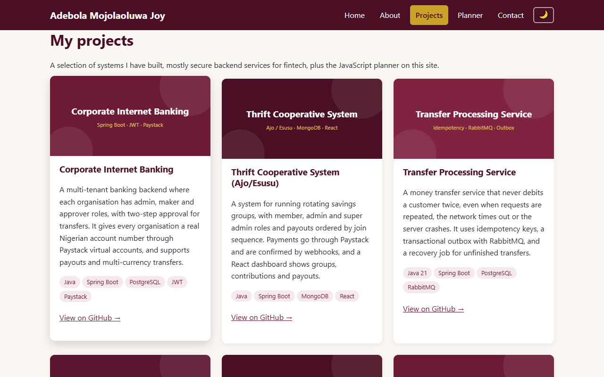

### 4.4 Study Planner (`planner.html`)

The planner is the main interactive feature of the site. It is a small task manager for assignments.

#### Step 1: The empty planner

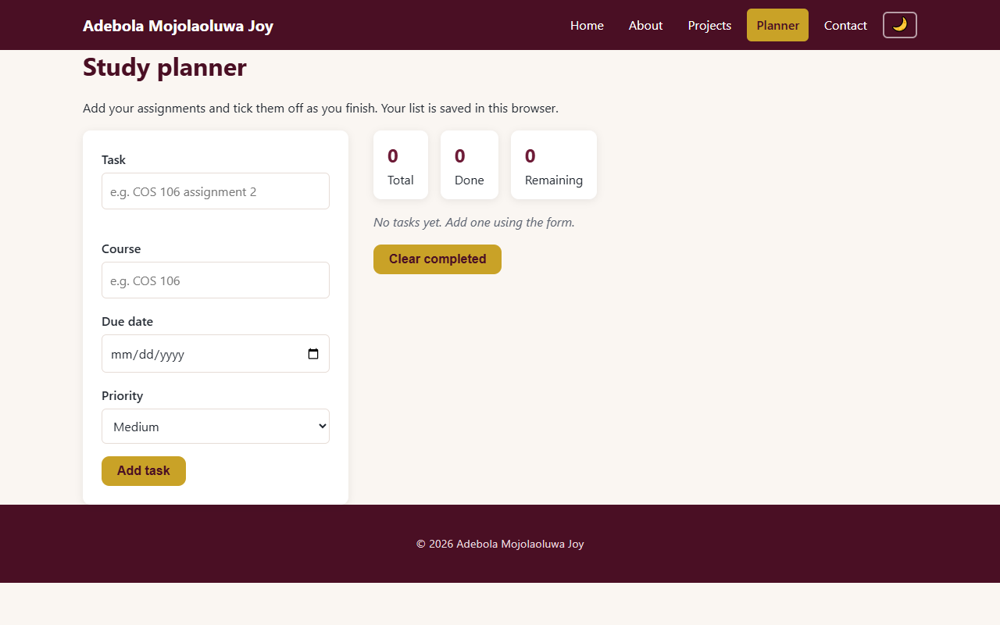

On the left is the **Add task** form: task name, course, due date and priority (Low / Medium / High). On the right are three counters (**Total**, **Done**, **Remaining**) and the task list. When there are no tasks yet, a message tells the user how to start.

#### Step 2: Validation

If the user clicks **Add task** without typing a task name, the task is not added. The field turns red and shows an error message:

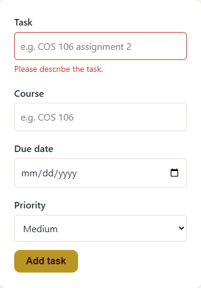

The course, due date and priority are optional. If the course is left blank, it is saved as "General".

#### Step 3: Adding tasks


Each new task **slides in** from the left. Each task shows its course, due date and priority, and a coloured left border shows the priority at a glance:

| Priority | Border colour |
|---|---|
| High | Red |
| Medium | Gold |
| Low | Green |

Tasks are **sorted automatically**: unfinished tasks first, then by the nearest due date.

#### Step 4: Completing and deleting tasks

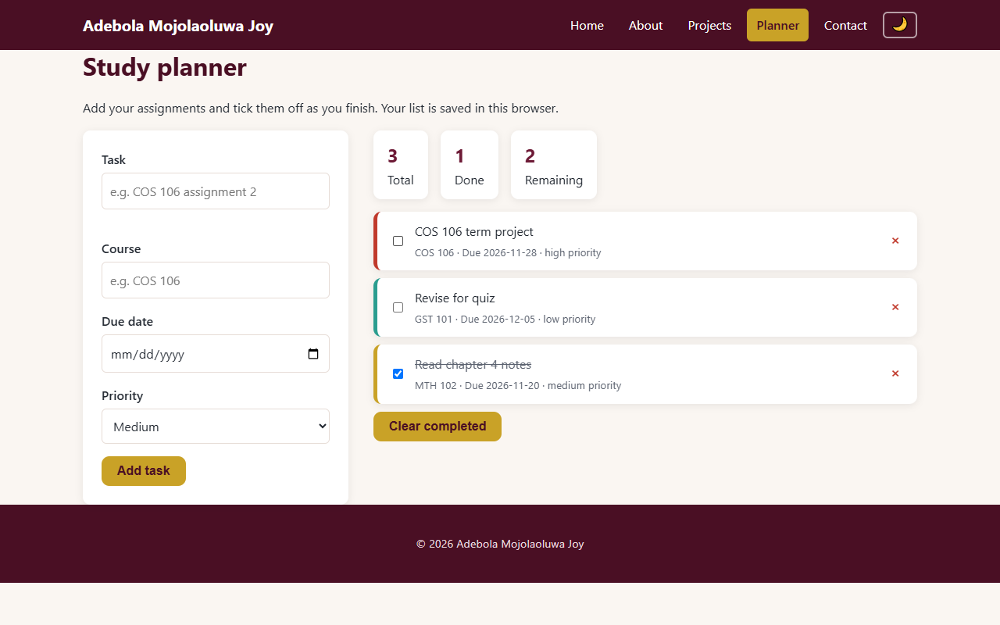

Ticking a task's **checkbox** marks it as done. Its title is crossed out, it moves to the bottom of the list, and the counters update immediately (here: 3 total, 1 done, 2 remaining).

#### Step 5: Deleting a task

Clicking the red **×** next to a task removes it from the list straight away. Below, "Revise for quiz" has been deleted from a list of four tasks, and the Total counter has dropped to 3:

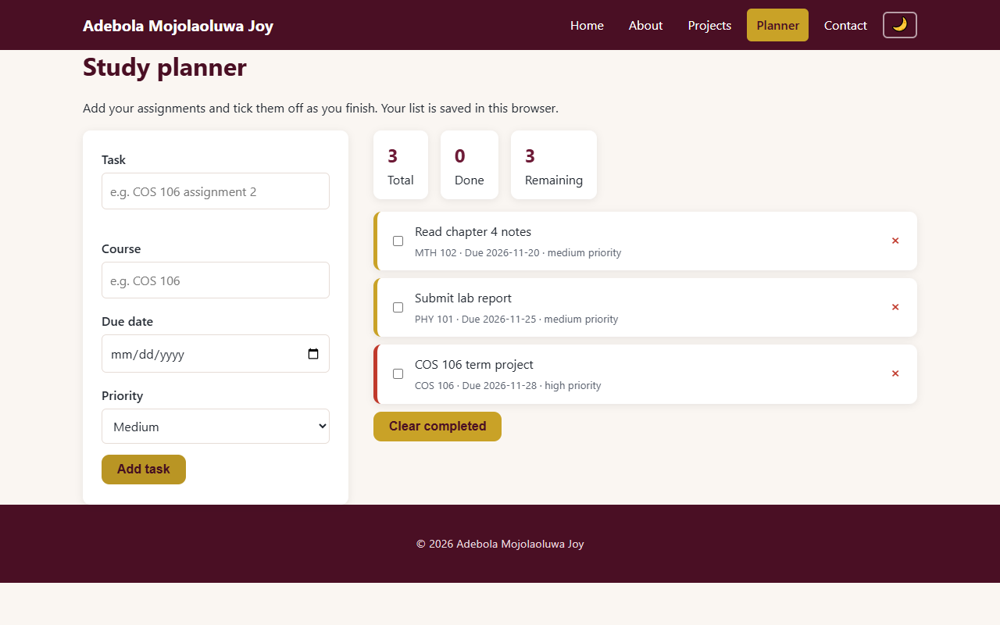

#### Step 6: Clearing completed tasks

**Clear completed** removes every finished task at once. Here two tasks are ticked as done:

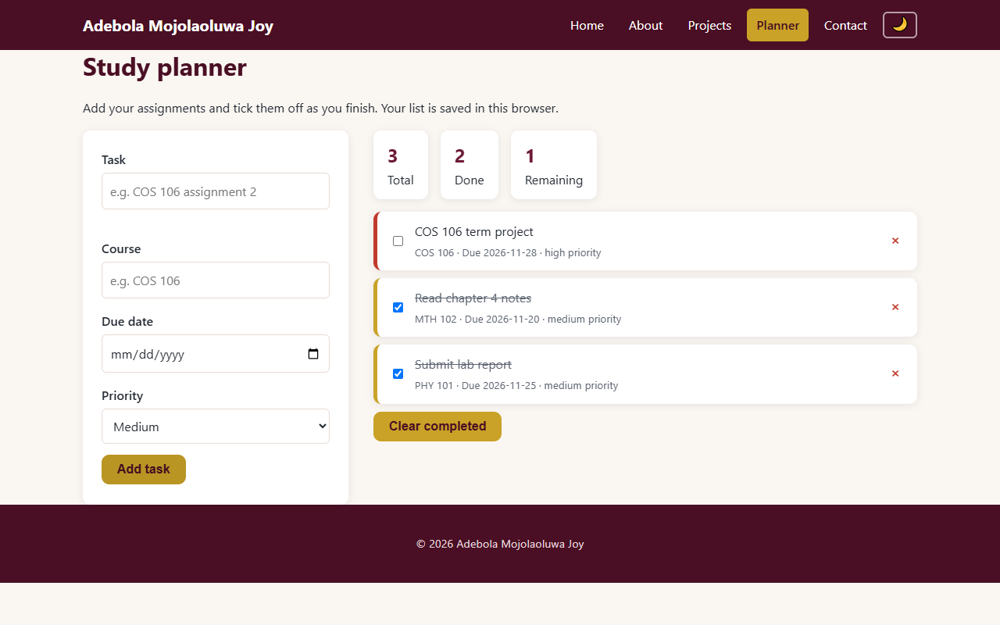

After clicking **Clear completed**, only the unfinished task is left and the counters reset to match:

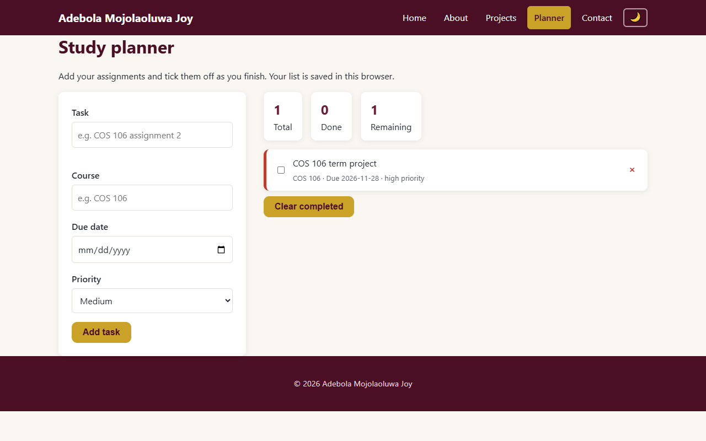

#### Step 7: Tasks are saved

The list is stored in the browser's `localStorage`. If the user refreshes the page, closes the tab or comes back the next day, the tasks are still there. Tasks are saved per browser, so a different browser or device starts with an empty list.

A short video of the planner is also embedded on the About page (`media/planner-demo.mp4`).

### 4.5 Contact page (`contact.html`)

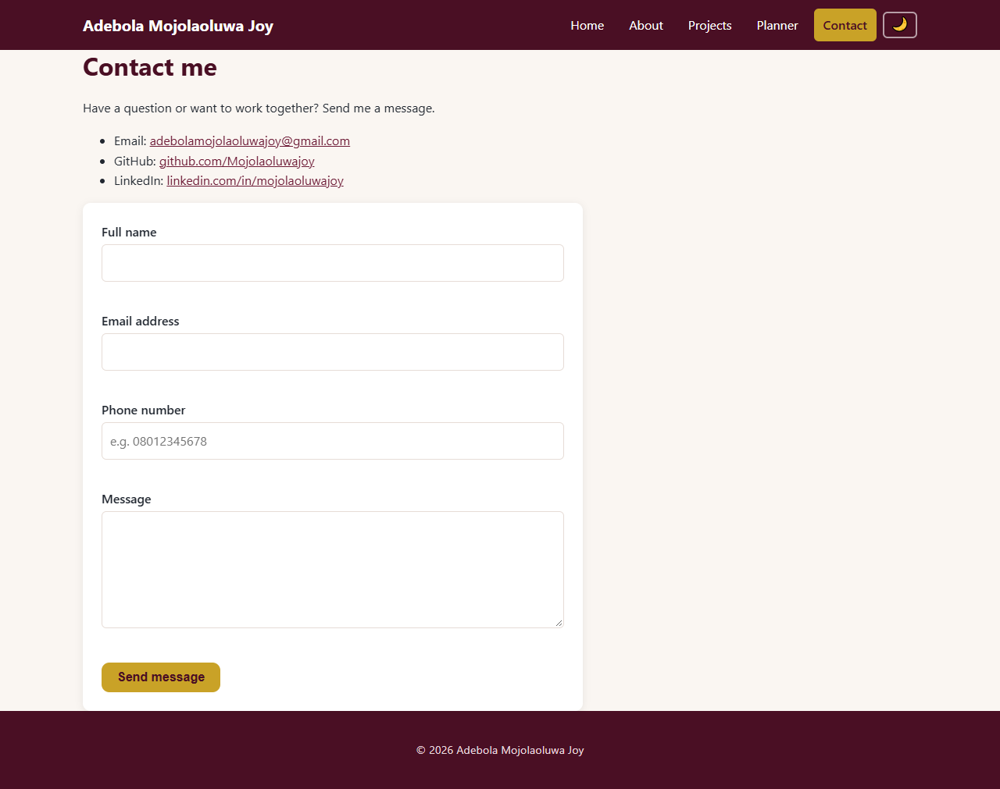

**What it shows:** the author's email, GitHub and LinkedIn links, and a contact form with **Full name**, **Email address**, **Phone number** and **Message** fields.

The form is checked by JavaScript before it is accepted. It applies three rules:

**Rule 1: No field may be empty.** Clicking **Send message** with empty fields highlights every one in red:

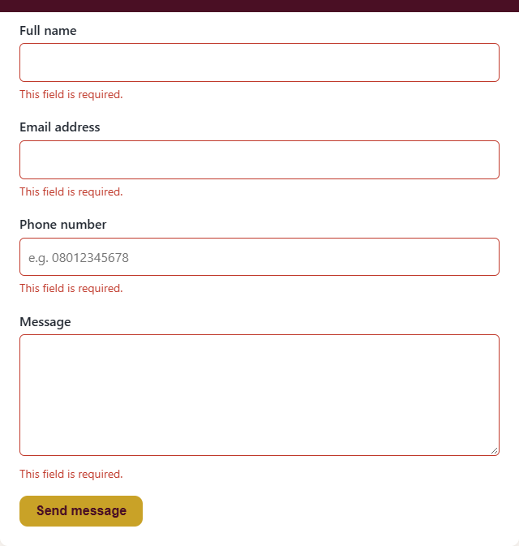

**Rule 2: The email must be valid** (for example `name@example.com`). **Rule 3: The phone number may contain digits only**, so dashes, spaces and letters are rejected:

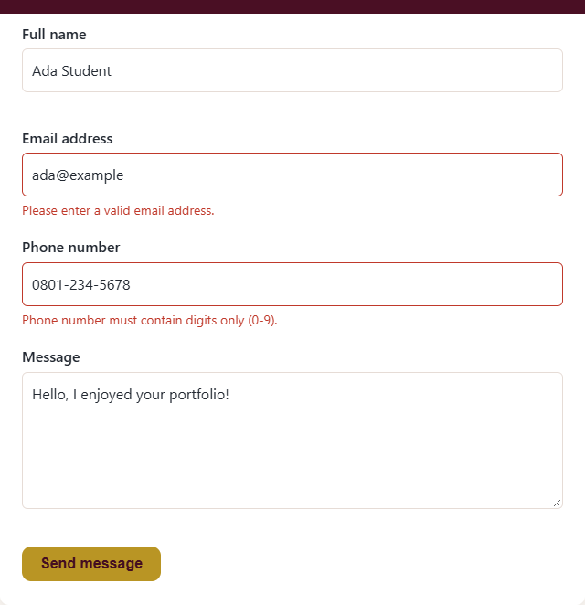

**When every rule passes,** a green success message appears and the form is cleared:

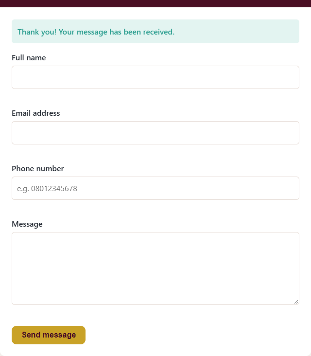

> **Note:** the site has no server, so the message is not actually sent anywhere. The form demonstrates client-side validation only. Visitors who want to make contact can use the email link above the form.

---

## 5. Responsive design and mobile menu

The site adapts to the screen size using two CSS **media queries**:

| Screen width | What changes |
|---|---|
| **≤ 800 px** (tablets) | About and Planner layouts change from two columns to one; the hero stacks with the photo on top |
| **≤ 640 px** (phones) | The navigation links are hidden behind a **☰ menu button**; the hero title gets smaller |

| Phone view | Menu opened |
|---|---|
| 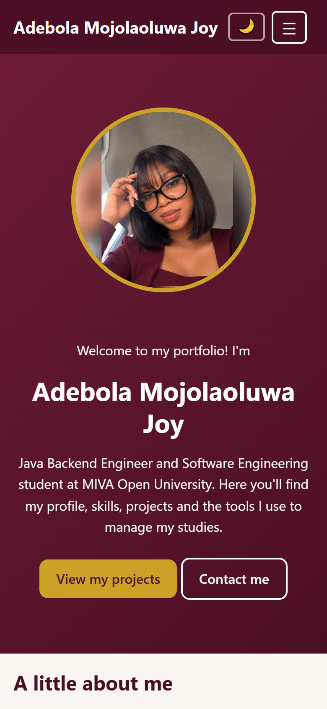 | 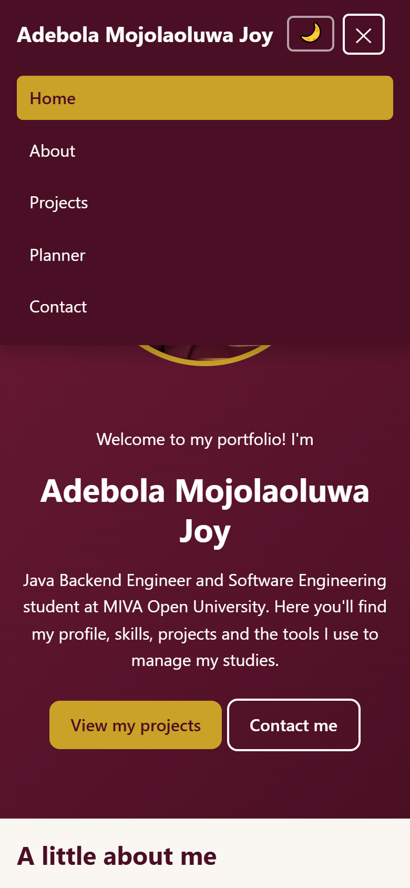 |

**How the mobile menu works**
1. Tapping **☰** adds the class `open` to the link list. CSS fades and slides the menu into view, and the icon changes to **✕**.
2. The menu closes when the user taps a link, taps anywhere outside the menu, taps **✕** or presses **Escape**.
3. The button's `aria-expanded` attribute is updated each time, so screen readers know whether the menu is open.

---

## 6. Light and dark mode

Every page has a **🌙 / ☀️ button** in the header. In light mode it shows a moon (click it to switch to dark); in dark mode it shows a sun (click it to switch back).

| Dark mode: Home | Dark mode: Study Planner |
|---|---|
| 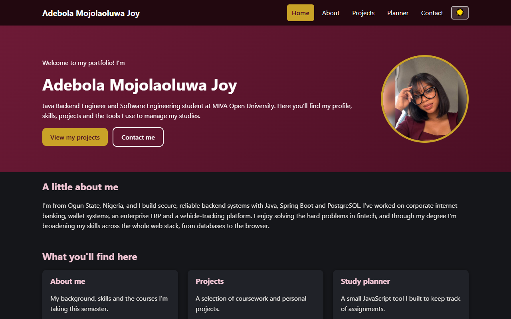 | 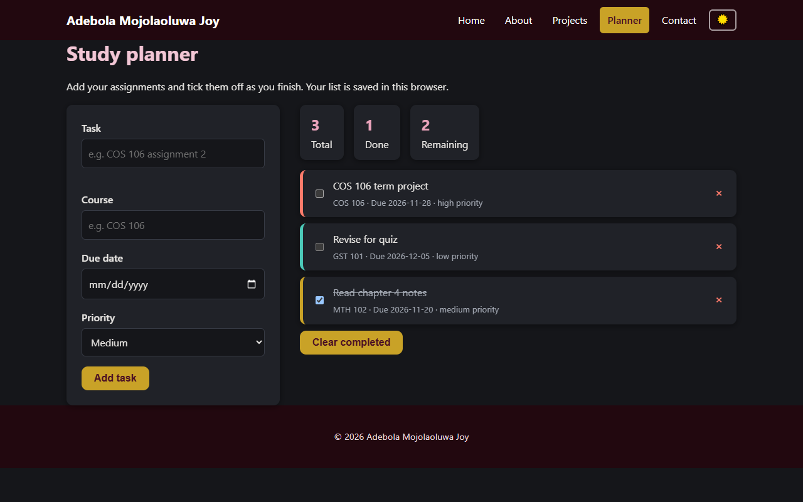 |

The dark theme keeps the same maroon and gold identity: backgrounds become near-black, cards become dark grey, text becomes light, and headings and links turn a soft pink so they stay readable. On phones the button sits next to the ☰ menu:

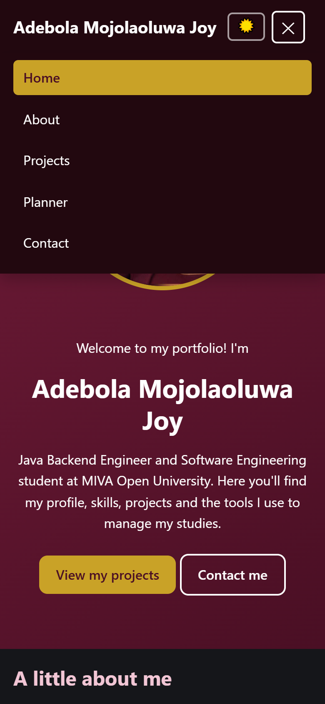

**How it decides which theme to show**
1. If the visitor has clicked the button before, their choice is used. It is saved in `localStorage` under the key `theme`, so it applies on every page and on later visits.
2. If they have never clicked it, the site follows their device: phones and computers set to dark mode get the dark theme automatically.

**How it works**
- All colours are CSS variables (see [section 8](#8-how-it-works-css)). Dark mode simply gives those variables different values, so no other CSS had to be duplicated.
- Clicking the button sets `data-theme="dark"` or `data-theme="light"` on the `<html>` element, and the CSS rule `:root[data-theme="dark"]` swaps the colours.
- A tiny script in each page's `<head>` applies the saved theme *before* the page is drawn, so a dark-mode visitor never sees a flash of the light theme while the page loads.
- `color-scheme: dark` tells the browser to draw its own controls (date picker, checkboxes, dropdowns) in dark colours too.

---

## 7. How it works: HTML

| Requirement | Where it is used |
|---|---|
| Semantic elements: `<header>`, `<nav>`, `<main>`, `<section>`, `<article>`, `<footer>` | Every page; each card is an `<article>` |
| Forms | Contact form (`contact.html`), task form (`planner.html`) |
| Tables | Education and work experience (`about.html`) |
| Lists | Navigation menu, skills, hobbies, contact links, task list |
| Images | Profile photo, project banners, video poster |
| Hyperlinks | Navigation, GitHub links, `mailto:` email link |
| Multimedia | `<video>` with controls and a poster (`about.html`) |

**Accessibility features**
- Every image has descriptive `alt` text.
- Every form field has a `<label>` connected to it with `for`/`id`.
- The menu button has `aria-label` and `aria-expanded`; task checkboxes and delete buttons have `aria-label`s such as *"Delete COS 106 term project"*.
- Every page has `lang="en"`, a viewport meta tag and a `meta description`.

---

## 8. How it works: CSS

`css/style.css` is divided into 11 numbered sections:

| # | Section | Purpose |
|---|---|---|
| 1 | Colour + spacing variables | The whole colour scheme defined once in `:root` |
| 1b | Dark mode | Dark values for the same colour variables |
| 2 | Reset + base | `box-sizing`, fonts, default link and heading colours |
| 3 | Header + navigation | Sticky header, nav links, active-page highlight |
| 4 | Hero | Home page banner |
| 5 | Sections + cards | Card grid, tags, buttons |
| 6 | About page | Photo/intro layout, tables, video box |
| 7 | Forms | Inputs, error (red) and success (green) styles |
| 8 | Study planner | Planner layout, counters, tasks, priority colours |
| 9 | Footer | Footer styling |
| 10 | Animations + transitions | Hover effects, fade-in, slide-in |
| 11 | Responsive | Media queries for tablets and phones |

### Colour scheme

All colours are **CSS variables**, so changing a value in `:root` changes it across the whole site:

| Variable | Value | Used for |
|---|---|---|
| `--primary` | `#6d1a36` (maroon) | Links, headings, hero background |
| `--primary-dark` | `#4a0f24` | Header, footer, headings |
| `--accent` | `#c9a227` (gold) | Buttons, active nav link, medium priority |
| `--bg` | `#faf6f2` (cream) | Page background |
| `--success` | `#2a9d8f` (green) | Success message, low priority |
| `--error` | `#c0392b` (red) | Error messages, high priority |

In dark mode these variables are given darker or lighter values (for example the background becomes `#15161a` and headings become `#f2c6d5`), so the whole site switches theme without any other changes.

### Layout
- **Flexbox:** header (logo left, links right), hero (text and photo), planner counters, task rows.
- **CSS Grid:** project and home cards (`auto-fit`), About layout (`280px 1fr`), Planner layout (`340px 1fr`).

### Animations and transitions

| Effect | Technique | Duration |
|---|---|---|
| Page content fades up on load | `@keyframes fadeUp` | 0.3 s |
| New planner tasks slide in | `@keyframes slideIn` | 0.2 s |
| Cards lift on hover | `transition` on `transform` and `box-shadow` | 0.15 s |
| Buttons rise slightly on hover | `transition` on `transform` | 0.15 s |
| Mobile menu fades/slides open | `transition` on `opacity` and `transform` | 0.15 s |

For users who have turned off animations in their operating system, `@media (prefers-reduced-motion: reduce)` switches all animations off.

---

## 9. How it works: JavaScript

All behaviour lives in `js/main.js`. When a page finishes loading, it runs five setup functions:

```js
document.addEventListener("DOMContentLoaded", function () {
  setupThemeToggle();
  setupMobileMenu();
  setFooterYear();
  setupContactForm();
  setupPlanner();
});
```

Each function first checks that the elements it needs are on the page. If they are not, it stops (`if (!form) return;`). This is how one script can serve all five pages safely.

(The one exception is a two-line script in each page's `<head>` that applies the saved theme before the page appears; see [section 6](#6-light-and-dark-mode).)

### 9.1 Functions

| Function | What it does |
|---|---|
| `setupThemeToggle()` | Switches between light and dark mode, saves the choice and updates the 🌙/☀️ icon |
| `setupMobileMenu()` | Opens/closes the ☰ menu; closes it on link click, outside click or Escape |
| `setFooterYear()` | Writes the current year into the footer |
| `setupContactForm()` | Validates the contact form on submit |
| `showError(input, text)` / `clearError(input)` | Add or remove the red border and error message under a field |
| `setupPlanner()` | Loads saved tasks and connects the add, tick, delete and clear actions |
| `loadTasks()` / `saveTasks(tasks)` | Read and write the task array to `localStorage` |
| `renderTasks(tasks)` | Rebuilds the task list and counters from the array |

### 9.2 Contact form validation flow

```
User clicks "Send message"
        │
        ▼
event.preventDefault()  ── stops the page from reloading
        │
        ▼
Rule 1: is any field empty? ──── yes ──► show "This field is required."
        │
        ▼
Rule 2: email matches /^[^\s@]+@[^\s@]+\.[^\s@]+$/ ? ── no ──► show email error
        │
        ▼
Rule 3: phone matches /^[0-9]+$/ ? ── no ──► show phone error
        │
        ▼
All valid ──► show green success message and reset the form
```

All rules are checked on every submit, so the user sees every problem at once instead of one at a time.

### 9.3 Planner data model

Tasks are kept in an **array of objects**. Each task looks like this:

```js
{
  id: 1763240000000,          // Date.now(): unique number for each task
  title: "COS 106 term project",
  course: "COS 106",          // "General" if left empty
  due: "2026-11-28",          // "" if no date was chosen
  priority: "high",           // "low" | "medium" | "high"
  done: false
}
```

The whole array is saved as JSON under the `localStorage` key **`studyPlannerTasks`**.

### 9.4 Planner update cycle

Every action follows the same three steps: **change the array, save it, redraw the list.**

```
 Add task / tick checkbox / delete / clear completed
                     │
                     ▼
          update the tasks array
     (push, set done, or filter out)
                     │
                     ▼
     saveTasks()  ──►  localStorage
                     │
                     ▼
     renderTasks()  ──►  rebuilds the <ul>,
                          updates Total / Done / Remaining,
                          shows or hides the "No tasks yet" message
```

Implementation details:
- **Event delegation:** instead of adding a listener to every checkbox and × button, one `click` listener sits on the whole `#task-list`. It uses `event.target.closest(".task")` and the task's `data-id` to work out which task was clicked. This also works for tasks added later.
- **Safe rendering:** task text is inserted with `textContent`, not `innerHTML`, so anything a user types is shown as plain text and can never run as code.
- **Sorting:** `renderTasks` sorts a *copy* of the array (`tasks.slice().sort(...)`): unfinished tasks first, then by due date. Tasks without a date go last.
- **Error handling:** `localStorage` calls are wrapped in `try/catch`. If storage is blocked (for example in some private-browsing modes), the planner still works for the current visit.

---

## 10. Running, testing and deploying

### Run locally
No installation is needed.
1. Clone or download the repository:
   ```
   git clone https://github.com/Mojolaoluwajoy/student-portfolio.git
   ```
2. Open `index.html` in any modern browser (Chrome, Edge, Firefox or Safari).

### Manual test checklist

| # | Test | Expected result |
|---|---|---|
| 1 | Click each nav link | Correct page opens; its link is highlighted in gold |
| 2 | Submit the contact form empty | All four fields show "This field is required." |
| 3 | Enter `ada@example` as the email | "Please enter a valid email address." |
| 4 | Enter `0801-234-5678` as the phone | "Phone number must contain digits only (0-9)." |
| 5 | Fill everything in correctly | Green success message; form clears |
| 6 | Add a planner task with no name | "Please describe the task." |
| 7 | Add three tasks | They appear sorted by due date; Total = 3 |
| 8 | Tick one task | It is crossed out, moves down; Done = 1, Remaining = 2 |
| 9 | Refresh the planner page | Tasks are still there |
| 10 | Click × / Clear completed | Task(s) removed; counters update |
| 11 | Narrow the window below 640 px | ☰ button appears; menu opens and closes |
| 12 | Play the video on the About page | Planner demo plays with controls |
| 13 | Click the 🌙 button | Site switches to dark mode; button shows ☀️ |
| 14 | Go to another page, or refresh | Dark mode is still on |

### Deploy
The site is hosted on **Vercel** (https://mojolaoluwajoy.vercel.app) and **GitHub Pages** (https://mojolaoluwajoy.github.io/student-portfolio/). Both are connected to the `main` branch on GitHub, so every push to `main` updates both sites within a minute or two. No build step is needed.

---

## 11. Limitations and future improvements

| Current limitation | Possible improvement |
|---|---|
| The contact form does not send messages (no server) | Connect it to a form service such as Formspree, or a small backend API |
| Planner tasks are stored only in one browser | Add user accounts and store tasks in a database so they sync across devices |
| Planner tasks cannot be edited after they are added | Add an edit button for each task |
| No reminders for due dates | Highlight overdue tasks and use browser notifications |
